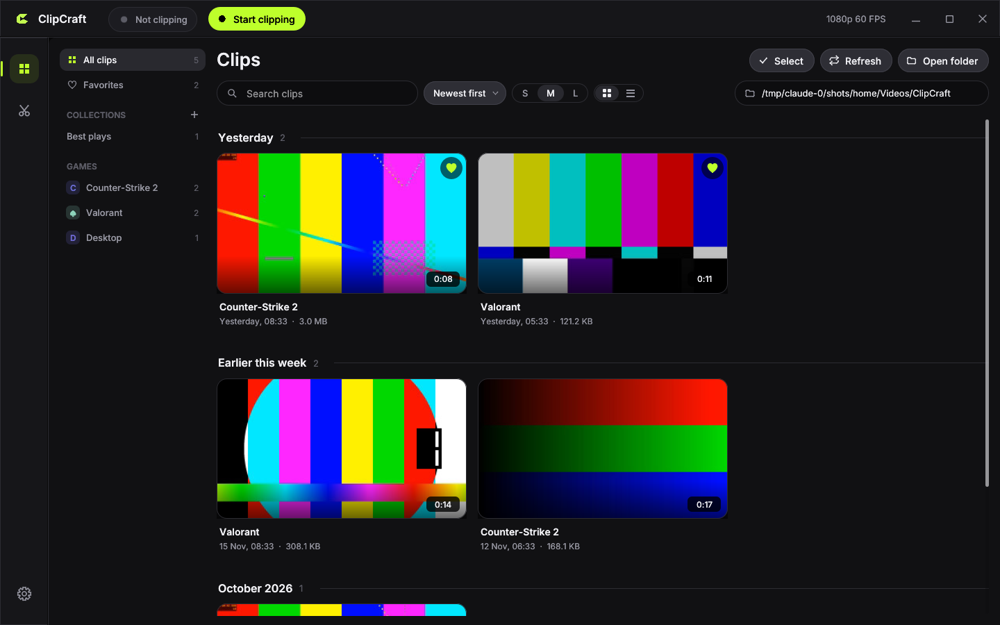
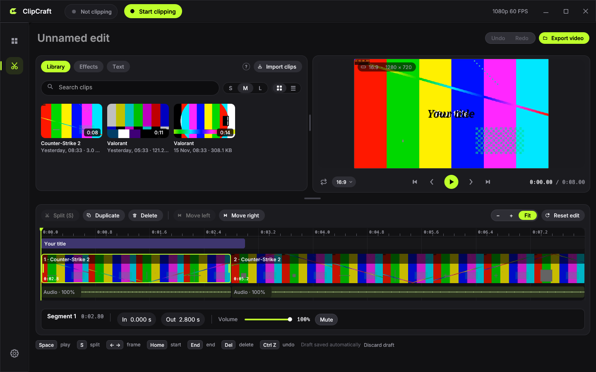
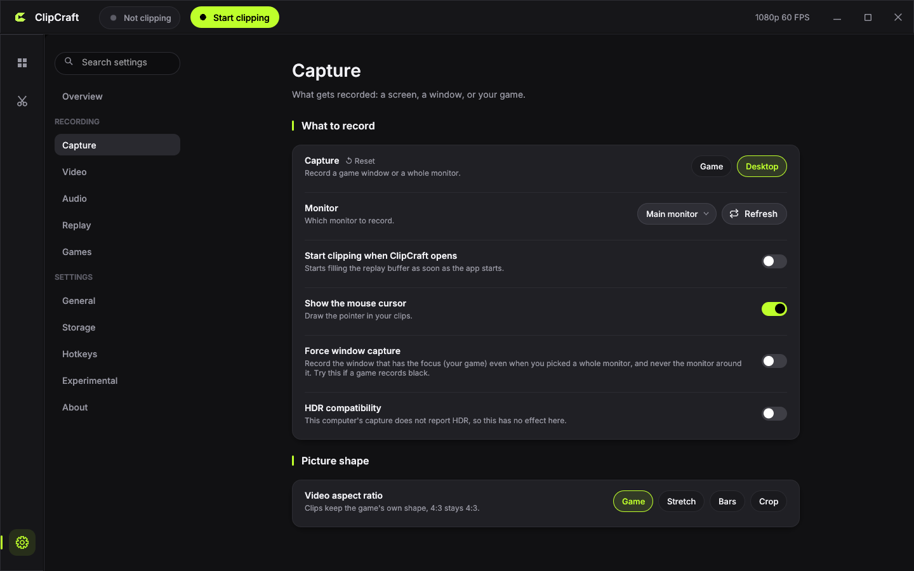

# ClipCraft

**Instant game clips that stay on your computer.** Record a replay buffer, press a key to save the
moment, then trim, edit and share it. No account, no server, no upload.

> **Early release (0.3.0).** Tested on Windows/AMD and Linux/X11 with generated captures. Real
> games, other graphics cards and Wayland are not fully tested, and macOS capture is not built yet.
> [`docs/gaps.md`](docs/gaps.md) lists what is verified and what is not.

## Get it

Download [ClipCraft 0.3.0](https://github.com/nanox333/clipcraft/releases/tag/v0.3.0): a Windows
installer (or portable zip) or a Linux tarball. Downloads are not code-signed, so Windows may warn;
choose *More info*, then *Run anyway*. ClipCraft can tell you about updates (Settings → About) and
never goes online if you turn that off.

## What you can do

- **Clip:** record a screen or game window into a replay buffer and save the last moments with a
  hotkey. Game-only mode follows a recognized game by itself.
- **Sound:** game, Discord, music and microphone on separate tracks, each with its own level.
- **Browse:** a searchable library with favorites, collections, game labels, a list or picture
  cards, and drag-to-reorder.
- **Choose many:** **Select** clips, drag a box around them, then favorite, collect or delete them
  together, with **Undo** (or **Delete now**).
- **Edit:** trim, split, fade, add styled text, step frame by frame, and export in 16:9, 9:16, 1:1
  and other shapes, or as a small file or GIF for Discord.
- **Share:** drag a clip straight into Discord or any program that takes files.
- **Script it:** `clipcraft-cli` runs the same commands as the app.

## Your clips stay safe

- Everything stays on your computer. Original clips are never overwritten by trim or export.
- Deleting goes to the Recycle Bin, and an Undo message stays up until you close it. The storage limit never touches favorites, clips in
  a collection or clips in an open edit.
- Every saved clip is reopened and checked for missing footage, and you are warned when the disk is getting full.
- Settings and the library keep rolling backups and recover from a damaged file.
- Experimental, off by default (Settings → Experimental): recording pauses while a password manager is open.
- If ClipCraft keeps failing to start, it opens with default settings and keeps your old ones.
- A watchdog slows down or stops clipping if it would starve your computer, and an internal error
  never closes the program or loses the replay.

## Screenshots





## Build and run

```sh
cargo install cargo-deny --version 0.20.2 --locked
cargo xtask ci            # the same checks as GitHub Actions
cargo run --package clipcraft
```

More on the command line, tests and benchmarks is in [`docs/testing.md`](docs/testing.md).

## Learn more

| | |
| --- | --- |
| [`docs/features.md`](docs/features.md) | every feature, with platform limits |
| [`docs/how-it-works.md`](docs/how-it-works.md) | recording, saving, the library and export, start to finish |
| [`docs/gaps.md`](docs/gaps.md) | what is verified, what is not |
| [`CHANGELOG.md`](CHANGELOG.md) | what each release contains |
| [`ROADMAP.md`](ROADMAP.md), [`docs/backlog.md`](docs/backlog.md) | what is planned |
| [`docs/architecture.md`](docs/architecture.md), [`docs/testing.md`](docs/testing.md) | how it is built and checked |
| [`CONTRIBUTING.md`](CONTRIBUTING.md), [`AGENTS.md`](AGENTS.md) | contributor rules |
| [`ATTRIBUTION.md`](ATTRIBUTION.md), [`docs/upstream-ports.md`](docs/upstream-ports.md) | assets, licenses and ports |

Not planned: voice or video calls, social feeds, share links. Planned: opt-in encrypted backups,
controller shortcuts and overlays.

Documentation ships with code: changes under `apps/`, `crates/` or `tools/` must update this file and
[`docs/gaps.md`](docs/gaps.md).
